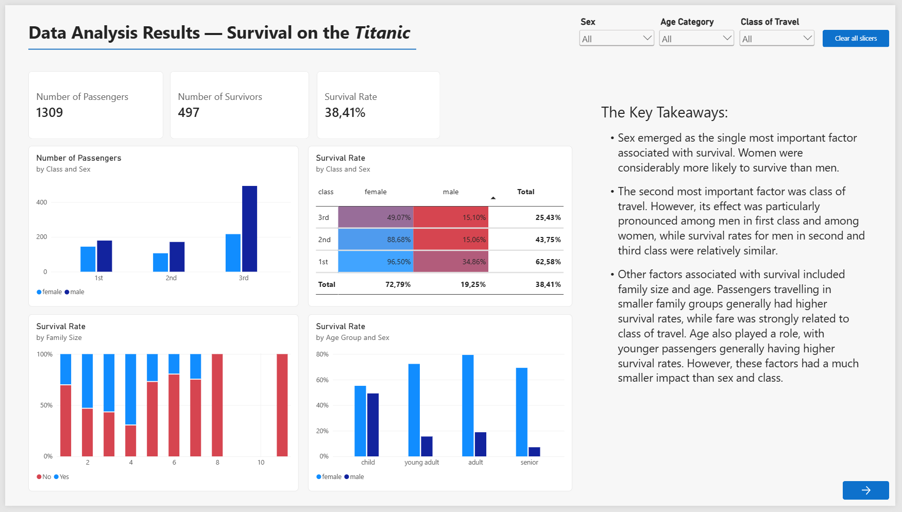
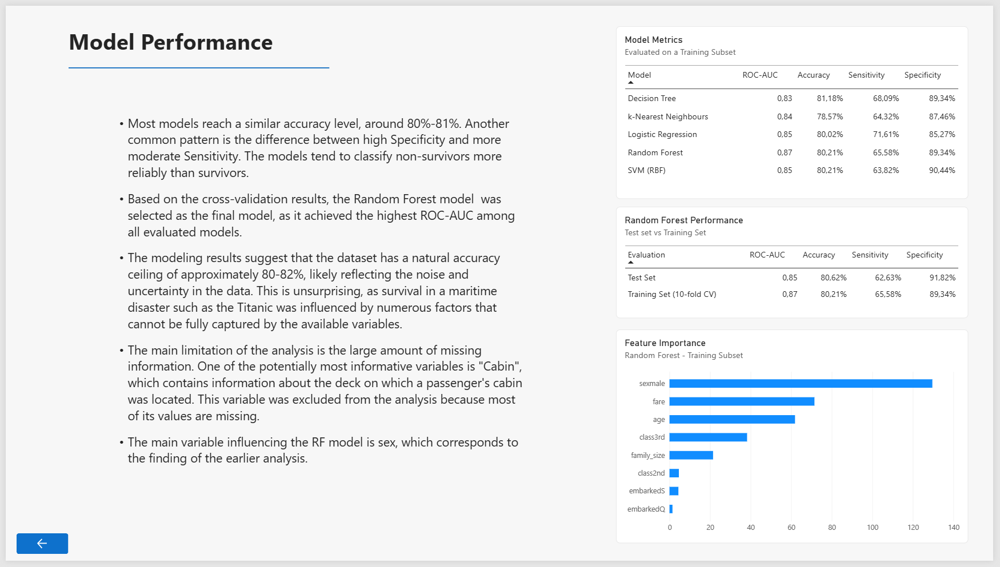

# About
The repository contains a data analysis project examining passenger survival on the Titanic. It includes an academic-style report written in **R and Quarto**, describing the entire analysis process, as well as an easy-to-read and comprehensive Power BI dashboard presenting the key findings.

---

## Power BI Preview

### Page 1: Survival Predictors

### Page 2: Modeling Results

---
## Data Sources
The analysis uses an extended Titanic dataset available on [Kaggle](https://www.kaggle.com/datasets/pavlofesenko/titanic-extended/data). To assist with the data cleaning process, the passenger list from [Wikipedia](https://en.wikipedia.org/wiki/Passengers_of_the_Titanic#Passenger_list) was also used.

## Technologies used
* Data Analysis & Modeling:
  - R, using packages such as 'tidyverse', 'knitr', 'caret', 'cluster', among others.
  - Python, used to scrape Wikipedia passenger list, with libraries such as 'pandas' and 'BeautifulSoup'.
* Academic Report: Quarto ('.qmd') - covers data preparation, exploratory data analysis (EDA), dimensionality reduction (PCA, MDS), unsupervised learning (PAM, AGNES), supervised learning (regression, k-NN, decision trees, random forest, and SVM), and evaluation on a test subset.
* BI report: Power BI Desktop ('.pbix') - presents the key finding through KPIs, visualisations, heatmaps, model comparisons, and feature importance analysis.

---
## Repository Structure
- '/bi_report' - Power BI project file ('.pbix') and exported report ('.pdf').
- '/data' - raw and processed datasets used for the analysis and BI report.
- '/python' - Python scripts used for data scraping.
- '/R' - R scripts for data processing, EDA, model training, and data visualisation.
- '/resources' - CSS styles for the Quarto report and images used in the README and report.
- '/titanic_data_analysis' - Quarto project files and the rendered HTML output.

